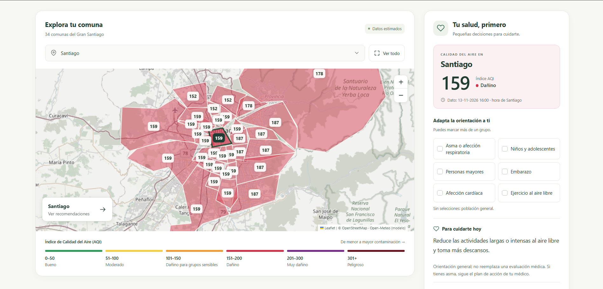

# Santiago500 sin smog

**Conoce el aire que respiras.**

Aplicación web en español para explorar la calidad del aire en las **34 comunas del Gran Santiago** y consultar orientación de salud según el índice AQI y distintos grupos de riesgo.

**[Abrir la aplicación](https://vescoar.pythonanywhere.com/)** · [Repositorio](https://github.com/vescoar/santiago500)

Proyecto desarrollado para **IWG400 — Proyecto Inicial**, Universidad Técnica Federico Santa María.

[](https://vescoar.pythonanywhere.com/)

*Vista de la aplicación. Haz clic en la imagen para explorar el mapa; los valores mostrados corresponden al momento de la captura.*

## Propósito

Acercar la información de calidad del aire a las personas y ayudar a interpretar lo que significa para sus actividades cotidianas. El mapa permite consultar una comuna y conectar su nivel de contaminación con orientación general de salud.

Los valores provienen de un modelo atmosférico de Open-Meteo. **No son mediciones de estaciones locales ni reemplazan la información oficial o una evaluación médica.**

## Cómo usar la aplicación

1. Elige una comuna haciendo clic en el mapa o usando el selector.
2. Consulta su AQI, categoría y fecha del dato en la ficha lateral.
3. Marca los grupos que correspondan para adaptar la orientación. Puedes combinar varios; sin selecciones, se muestra orientación para la población general.
4. Usa **Limpiar** para restablecer los grupos y **Ver todo** para ver los límites completos de las comunas.

En celular, el panel de salud aparece debajo del mapa. El enlace **Ver recomendaciones** lleva directamente a él.

## Funcionalidades

- **Mapa por comuna:** polígonos coloreados según el AQI, etiquetas numéricas al acercar el mapa y resaltado de la comuna elegida.
- **Orientación de salud:** consejos para asma u otras afecciones respiratorias, niños y adolescentes, personas mayores, embarazo, enfermedades cardiovasculares y ejercicio al aire libre.
- **Navegación accesible:** selector utilizable con teclado, categorías escritas junto a los colores e interfaz adaptable a computador, tablet y celular.
- **Persistencia:** almacenamiento de zonas de monitoreo y registros de AQI en SQLite.
- **Consulta periódica:** el navegador vuelve a pedir información cada 10 minutos mientras la página permanece abierta. El botón **Actualizar** permite repetir la consulta manualmente.
- **Manejo de fallos de la fuente externa:** ante errores de consulta controlados, se devuelven los últimos registros guardados y se muestra un aviso.
- **Administración:** consulta de zonas y registros desde el administrador de Django.

## Cómo funciona

1. Django entrega la página principal y el navegador carga los límites de las comunas desde `comunas.geojson`.
2. El navegador consulta `/api/estaciones/`.
3. Django revisa un estado de actualización compartido en SQLite. Si ya terminó la espera, reserva el intento y consulta Open-Meteo con las coordenadas aproximadas de las 34 comunas. Las demás peticiones reutilizan los datos guardados.
4. Los datos nuevos se guardan en SQLite, evitando duplicados para una misma zona y fecha del dato.
5. El endpoint devuelve el último AQI disponible por comuna. El navegador actualiza los colores, las etiquetas y la ficha seleccionada.
6. La orientación se calcula en el navegador según el AQI y los grupos elegidos, sin enviar esas selecciones al servidor.

La fecha del dato y la fecha de guardado son distintas. Una consulta exitosa puede devolver un dato con una fecha ya existente y no crear registros nuevos; aun así se respetan 10 minutos antes de la siguiente consulta externa. Si Open-Meteo responde HTTP 429, se espera una hora o el plazo indicado por su cabecera `Retry-After` (con un mínimo de 10 minutos). El aviso y la espera se conservan entre visitas. **No hay un proceso programado que recolecte datos cuando nadie consulta la aplicación.**

## Tecnologías

| Componente | Tecnología |
| --- | --- |
| Servidor y administración | Python y Django |
| Base de datos | SQLite |
| Interfaz | HTML, CSS y JavaScript |
| Mapa interactivo | Leaflet |
| Mapa base | OpenStreetMap |
| Calidad del aire | API de Open-Meteo Air Quality |
| Límites geográficos | GeoJSON de comunas de Chile |
| Alojamiento de la versión publicada | PythonAnywhere |

### Modelo de datos

| Modelo | Información almacenada |
| --- | --- |
| `ZonaMonitoreo` | Identificador de la zona, nombre de la comuna, latitud y longitud. |
| `RegistroContaminacion` | Zona asociada, AQI, fecha del dato (`medido_en`) y fecha de guardado (`creado_en`). |
| `EstadoActualizacion` | Próximo intento permitido y aviso de la última consulta. Se utiliza un registro compartido para limitar las llamadas externas. |

Una zona puede tener varios registros. La combinación de zona y fecha del dato es única. La interfaz muestra el registro más reciente; el historial se conserva en la base de datos.

## Instalación local

Requisitos: **Python 3.12 o superior**, Git y conexión a Internet para descargar dependencias, consultar la API y cargar los recursos externos del mapa. Las versiones de los paquetes están definidas en `requirements.txt`.

### Windows

Desde PowerShell o el Símbolo del sistema:

```powershell
git clone https://github.com/vescoar/santiago500.git
cd santiago500
python -m venv venv
.\venv\Scripts\python.exe -m pip install -r requirements.txt
.\venv\Scripts\python.exe manage.py migrate
.\venv\Scripts\python.exe manage.py runserver
```

Se utiliza directamente el Python del entorno virtual para evitar depender de su activación en PowerShell.

### Linux o macOS

```bash
git clone https://github.com/vescoar/santiago500.git
cd santiago500
python3 -m venv venv
source venv/bin/activate
python -m pip install -r requirements.txt
python manage.py migrate
python manage.py runserver
```

Abre **http://127.0.0.1:8000/**. La primera consulta puede tardar unos segundos mientras se obtienen los datos.

Open-Meteo no requiere un token para esta integración. El GeoJSON ya viene incluido. La base `db.sqlite3` se crea con las migraciones y no se incluye en el repositorio.

Para acceder a `/admin/`, ejecuta `python manage.py createsuperuser` usando el Python de tu entorno virtual.

## Despliegue en PythonAnywhere

La versión publicada utiliza Django con SQLite y archivos estáticos servidos por PythonAnywhere. Para repetir el despliegue, sustituye `TU_USUARIO` por el usuario de la cuenta.

### 1. Preparar el proyecto

En una consola **Bash de PythonAnywhere**:

```bash
git clone https://github.com/vescoar/santiago500.git
cd ~/santiago500
mkvirtualenv --python=/usr/bin/python3.13 santiago500-env
pip install -r requirements.txt
```

### 2. Configurar la copia de producción

El código del repositorio conserva configuración de desarrollo. En la copia del servidor, reemplaza las asignaciones correspondientes de `santiago500sinsmog/settings.py` por:

```python
SECRET_KEY = os.environ["DJANGO_SECRET_KEY"]
DEBUG = False
ALLOWED_HOSTS = ["TU_USUARIO.pythonanywhere.com"]
```

Para generar la clave en un archivo `.env` sin mostrarla en pantalla, ejecuta desde la carpeta que contiene `manage.py`:

```bash
python -c "from pathlib import Path; import secrets; f = Path('.env').open('a'); f.write('\nDJANGO_SECRET_KEY=' + secrets.token_urlsafe(50) + '\n'); f.close()"
```

La configuración ya carga `.env` desde esa carpeta. Tanto ese archivo como la base SQLite y los archivos estáticos recopilados están excluidos del repositorio.

```bash
python manage.py migrate
python manage.py collectstatic --noinput
python manage.py check
python manage.py test santiago500
```

### 3. Crear la aplicación web

En **Web → Add a new web app**, selecciona **Manual configuration** y **Python 3.13**, la misma versión del entorno virtual.

| Campo | Valor |
| --- | --- |
| Source code | `/home/TU_USUARIO/santiago500` |
| Working directory | `/home/TU_USUARIO/santiago500` |
| Virtualenv | `/home/TU_USUARIO/.virtualenvs/santiago500-env` |

En el archivo **WSGI configuration file** enlazado desde la pestaña Web, utiliza:

```python
import os
import sys

project_path = "/home/TU_USUARIO/santiago500"
if project_path not in sys.path:
    sys.path.insert(0, project_path)

os.environ["DJANGO_SETTINGS_MODULE"] = "santiago500sinsmog.settings"

from django.core.wsgi import get_wsgi_application

application = get_wsgi_application()
```

### 4. Publicar los archivos estáticos

En **Web → Static files**, añade:

| URL | Directorio |
| --- | --- |
| `/static/` | `/home/TU_USUARIO/santiago500/staticfiles` |

Pulsa **Reload**. Comprueba la página principal, `/static/santiago500/mapa.css` y `/api/estaciones/`. Ante un error, consulta **Web → Log files → Error log**.

Después de actualizar estilos o scripts, vuelve a ejecutar `python manage.py collectstatic --noinput` y pulsa **Reload**. Conserva la configuración de producción al actualizar el código.

Referencias: [desplegar un proyecto Django existente](https://help.pythonanywhere.com/pages/DeployExistingDjangoProject/) y [configurar archivos estáticos](https://help.pythonanywhere.com/pages/DjangoStaticFiles/).

## Rutas disponibles

| Ruta | Resultado |
| --- | --- |
| `/` | Mapa y orientación de salud. |
| `/api/estaciones/` | JSON con `estaciones` y `aviso`. Cada entrada incluye nombre, coordenadas, AQI y fecha del dato. |
| `/admin/` | Administración de zonas y registros; requiere una cuenta autorizada. |

El nombre `/api/estaciones/` se conserva, aunque actualmente representa comunas con datos modelados y no estaciones físicas.

## Estructura del repositorio

```text
santiago500/
├── manage.py
├── requirements.txt
├── preparar_comunas.py          # Generación del GeoJSON
├── santiago500sinsmog/          # Configuración y entrada de Django
├── tests/
│   └── salud.test.cjs           # Pruebas de la lógica de orientación
└── santiago500/                 # Aplicación principal
    ├── models.py               # Zonas y registros de contaminación
    ├── services.py             # Consulta a Open-Meteo y persistencia
    ├── views.py                # Página y endpoint de datos
    ├── urls.py
    ├── admin.py
    ├── migrations/
    ├── static/santiago500/
    │   ├── comunas.geojson     # Límites de las 34 comunas
    │   ├── mapa.css            # Diseño adaptable
    │   ├── mapa.js             # Interacciones y carga de datos
    │   └── salud.js            # Categorías AQI y orientación
    └── templates/santiago500/
        └── mapa.html
```

## Comprobaciones

Con el entorno de Python del proyecto:

```bash
python manage.py check
```

Para las pruebas de orientación, necesitas **Node.js 18 o superior**, sin instalar paquetes adicionales:

```bash
node --test tests/salud.test.cjs
```

Las pruebas de Django verifican la espera entre consultas, el manejo del límite HTTP 429 y la conservación de los datos ante errores. La suite JavaScript verifica los límites de las categorías AQI, las diferencias entre población general y grupos sensibles, la combinación de perfiles y el rechazo de valores inválidos. Estas pruebas comprueban la lógica del programa; no constituyen una validación clínica.

Para revisar la interfaz, selecciona una comuna, combina grupos y comprueba que la orientación cambie. Prueba también **Limpiar**, el selector con teclado y el enlace móvil **Ver recomendaciones**.

### Regenerar los límites geográficos

Solo es necesario si quieres reconstruir el archivo incluido:

```bash
python preparar_comunas.py
```

Ejecuta el comando desde la carpeta de `manage.py`. El script descarga los límites de Chile, filtra las 34 comunas del Gran Santiago y escribe `santiago500/static/santiago500/comunas.geojson`.

## Alcance y limitaciones

- **Cobertura:** las 32 comunas de la provincia de Santiago, más Puente Alto y San Bernardo.
- **Representación aproximada:** se consulta un punto por comuna. El color de todo el polígono no representa variaciones internas y los límites pueden incluir sectores rurales o cordilleranos.
- **Resolución del modelo:** comunas cercanas pueden tener el mismo valor. La escala visual del mapa no implica precisión a nivel de calle.
- **Disponibilidad:** la API externa puede fallar o devolver datos con una fecha ya consultada. La ficha permite revisar la fecha del dato en hora de Santiago.
- **Orientación general:** se adapta de las guías EPA/AirNow de partículas y ozono. No identifica el contaminante dominante ni reemplaza una evaluación médica. Las personas con asma deben seguir el plan de acción indicado por su médico.
- **Selecciones de salud:** permanecen en la página abierta y no se guardan en la base de datos.
- **Contaminantes:** aunque la consulta solicita también PM2.5, actualmente solo se guarda y presenta el AQI.

Durante el desarrollo se evaluó WAQI/AQICN. Según las pruebas documentadas del equipo, las estaciones consultadas no entregaban valores de AQI utilizables en ese momento. Se optó por Open-Meteo, comunicando que sus datos son estimaciones.

## Posibles mejoras

- Recolección programada independiente de las visitas al sitio.
- Visualización del historial de AQI por comuna.
- Incorporación de contaminantes individuales y sus unidades.
- Integración de mediciones oficiales cuando exista una fuente adecuada.

## Fuentes y créditos

- [Open-Meteo Air Quality](https://open-meteo.com/en/docs/air-quality-api): datos de calidad del aire basados en modelos CAMS.
- [OpenStreetMap](https://www.openstreetmap.org/copyright): mapa base y sus colaboradores.
- [Leaflet](https://leafletjs.com/): biblioteca del mapa interactivo.
- [Chile-GeoJSON, de fcortes](https://github.com/fcortes/Chile-GeoJSON): límites comunales.
- EPA/AirNow: guías de [contaminación por partículas](https://document.airnow.gov/air-quality-guide-for-particle-pollution.pdf) y [ozono](https://document.airnow.gov/air-quality-guide-for-ozone.pdf), utilizadas para adaptar la orientación de salud.

## Equipo

- Vicente Escobar
- Christian Franco
- Antonia Estrada
- Alexander Friant
- Jose Francisco Escobar
